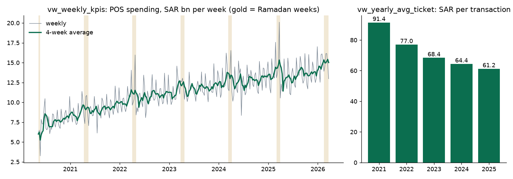
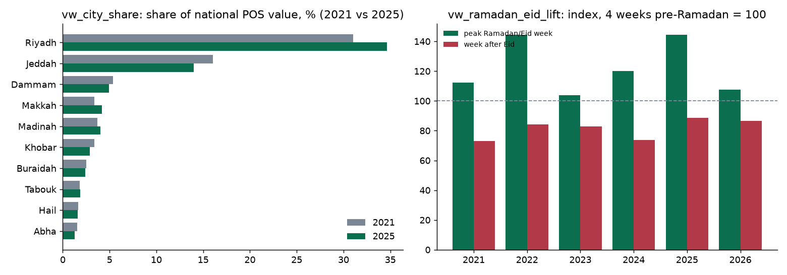
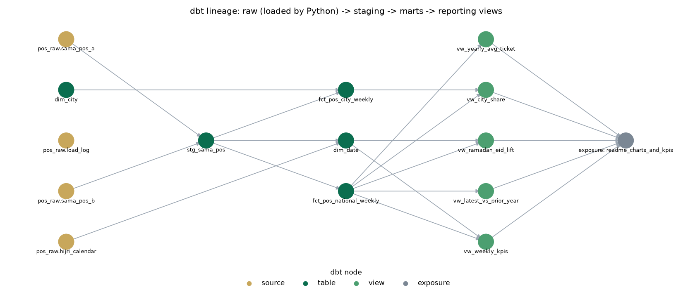
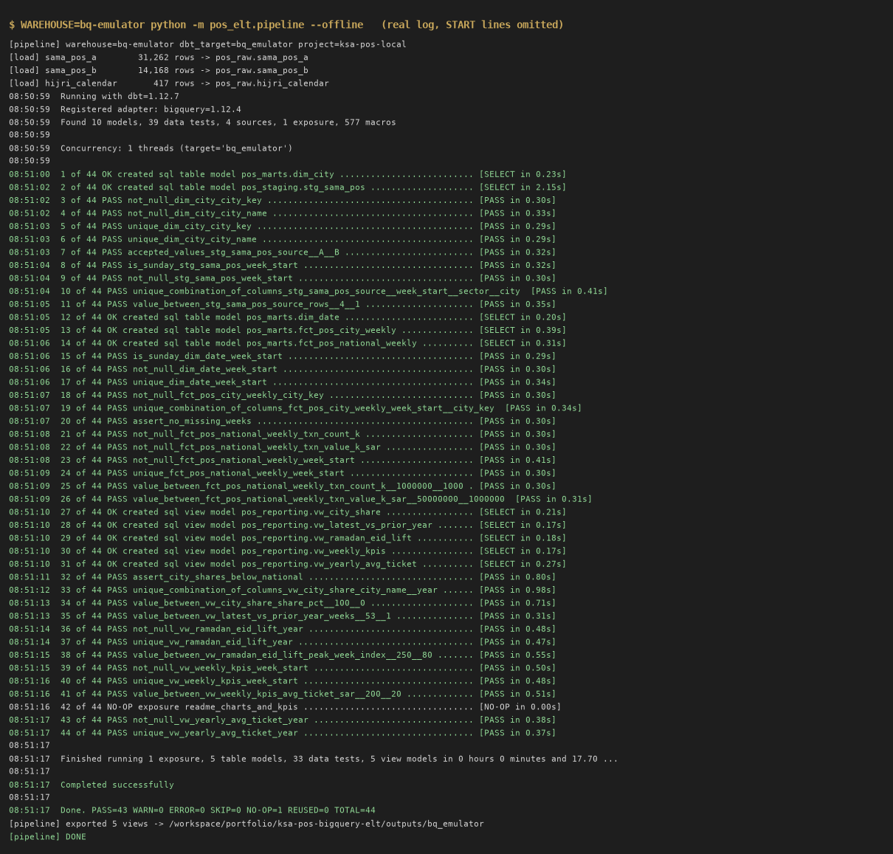

# KSA POS cloud ELT: SAMA weekly card spending → BigQuery-ready warehouse with dbt

> **Status: BigQuery-ready; cloud deploy pending account setup.** The full pipeline runs end to end on a local **DuckDB** warehouse and, in CI, on the open-source **BigQuery emulator** (same loader, same dbt models, BigQuery SQL dialect), and both engines return identical results. It has **not yet run on real Google BigQuery**: that needs a free BigQuery-sandbox project and one GitHub secret, set up by the owner (steps [below](#go-live-on-bigquery-free-sandbox-no-card)). Until then the cloud job in CI is skipped on purpose.

**Business question:** *How fast is card spending at Saudi points of sale still growing, where is it going (cities, ticket size), and how big is the Ramadan/Eid swing? And can a team get those answers refreshed every week from a cloud warehouse instead of a manual spreadsheet?*

**Answer (307 weeks of official SAMA data, 2020-05-10 to 2026-03-22):**

| | Finding (from the 5 SQL views; numbers come from [`outputs/kpis.json`](outputs/kpis.json)) |
|---|---|
| Growth is slowing | Average weekly POS spending rose from **SAR 9.08 bn** (2021) to **SAR 13.57 bn** (2025), **+49.3%**, but year-on-year growth fell every year (18.0% → 9.8% → 8.6% → 6.2%). The first 12 weeks of 2026 were **+3.4%** on the same weeks of 2025. |
| Smaller tickets | Transactions grew **+123.1%** while the average ticket fell from **SAR 91.4** to **SAR 61.2** (-33.1%): cards now cover everyday small purchases. |
| Riyadh gains share | Riyadh's share of national POS value went from **31.0%** to **34.6%**; Jeddah's fell from **16.1%** to **14.0%**. |
| Ramadan/Eid swing | The peak Ramadan-to-Eid week ran 4% to 45% above the 4 pre-Ramadan weeks (median index 116); the week after Eid fell to 73–89. |




**Run it (no account, about 15 seconds after install):**

```bash
python -m venv .venv && . .venv/bin/activate && pip install -r requirements.txt
PYTHONPATH=src python -m pos_elt.pipeline --offline      # load -> dbt build (10 models, 39 tests) -> export
PYTHONPATH=src python -m pytest -q
```

---

## What it does

```
KAPSARC public API ──► Python loader ──────────► raw dataset ──► dbt ───────────────────────────────► 5 reporting views ──► CSV / kpis.json / charts
 (SAMA weekly POS,      SHA-256 change detection,  pos_raw.*      staging (table) ─► marts (tables) ─►  pos_reporting.vw_*      (or Looker Studio,
  no key)               load jobs, load_log                       stg_sama_pos       dim_date, dim_city                          Tableau, Power BI)
                                                                                     fct_pos_national_weekly
                                                                                     fct_pos_city_weekly
        WAREHOUSE=duckdb (default)  |  WAREHOUSE=bq-emulator (CI)  |  WAREHOUSE=bigquery (after account setup)
```



| Layer | What | Where |
|---|---|---|
| Extract | Downloads the two SAMA POS releases from the KAPSARC Data Portal API and records URL, size, SHA-256 and time in `data/raw/manifest.json`. | `src/pos_elt/download.py` |
| Load | One **warehouse adapter** (`DuckDBWarehouse` / `BigQueryWarehouse`) chosen by the `WAREHOUSE` env var. Unchanged files are skipped by hash; every attempt, including failures, is appended to `pos_raw.load_log`; a failed source does not stop the others but fails the run. Builds a Hijri (Umm al-Qura) week calendar with Ramadan/Eid flags. | `src/pos_elt/warehouse.py`, `load.py`, `calendar.py` |
| Transform | dbt project with three targets (`duckdb`, `bq_emulator`, `bigquery`). Portable SQL; the few dialect differences (day-of-week, date arithmetic) are adapter-dispatched macros. | `dbt/` |
| Serve | 5 views in `pos_reporting`: **`vw_weekly_kpis`** (value, volume, avg ticket, 4-week avg, WoW, vs 52 weeks ago), **`vw_yearly_avg_ticket`**, **`vw_city_share`**, **`vw_ramadan_eid_lift`**, **`vw_latest_vs_prior_year`**. | `dbt/models/reporting/` |
| Schedule | GitHub Actions cron every Monday 04:00 UTC (07:00 Riyadh): re-downloads SAMA data and rebuilds; the BigQuery job runs only when the `GCP_SA_KEY` secret exists. | `.github/workflows/elt.yml` |

**Built for the free BigQuery sandbox.** The sandbox needs no card but allows no DML (`INSERT/UPDATE/DELETE/MERGE`) or streaming, and tables expire after 60 days. So every write is a **load job** (`WRITE_TRUNCATE` / `WRITE_APPEND`), dbt uses only `table` and `view` materialisations (DDL), and a test fails the build if anyone adds DML or an incremental model. The weekly job re-creates expired tables (a raw table that has expired is reloaded even if the file hash is unchanged).

## Tests and checks

* **dbt: 39 data tests** (on DuckDB; the CI emulator run executes 33): unique/not-null/relationships, re-implemented `unique_combination_of_columns` and `value_between` generic tests, an `is_sunday` test, and singular tests:
  * releases A and B agree within 0.01% for KSA and every city in their overlap weeks (this is what justifies stitching them);
  * the national fact reconciles to the raw KSA-total rows to within SAR 1 thousand;
  * the weekly series has no missing weeks;
  * named cities never exceed 100% of the national total.
* **Source freshness** on `_loaded_at` (warn after 8 days, error after 35).
* **pytest**: adapter switching, Hijri calendar flags, CSV parsing with BOM and unknown-indicator rejection, loader hash-skip / reload / failure logging, sandbox no-DML guard, CI gating, README-vs-`kpis.json` drift test, and a **cross-repo reconciliation**: the KPIs must equal those published by [ksa-pos-spending-dashboard](https://github.com/amirator/ksa-pos-spending-dashboard), which built the same numbers with hand-written DuckDB SQL.
* **BigQuery parity (CI)**: the `bigquery-emulator` job runs the identical pipeline against [goccy/bigquery-emulator](https://github.com/goccy/bigquery-emulator) v0.8.1 (checksum-verified) and asserts all 5 views equal the DuckDB views. Real log: [`docs/run_logs/bq_emulator_run.txt`](docs/run_logs/bq_emulator_run.txt).



## Go live on BigQuery (free sandbox, no card)

These steps need the repository owner's own Google account, so they have not been done yet. Nothing here costs money: the sandbox has no billing account, 10 GiB storage and 1 TiB of queries a month free (this project uses a few MB).

1. Go to <https://console.cloud.google.com/bigquery>, sign in with a Google account, accept the terms and **create a project** (e.g. `ksa-pos-elt`). Do **not** add a billing account; the page should show the "sandbox" banner. Note the **project ID**.
2. In **IAM & Admin → Service accounts**, create a service account `pos-elt-ci` and grant it two roles on the project: **BigQuery Data Editor** and **BigQuery Job User**.
3. Open the service account → **Keys → Add key → Create new key → JSON**. A `.json` file downloads. Treat it like a password and never commit it.
4. In GitHub: **amirator/ksa-pos-bigquery-elt → Settings → Secrets and variables → Actions → New repository secret**, name **`GCP_SA_KEY`**, and paste the whole JSON file. (Optional **variables**: `BQ_PROJECT` if it differs from the key's project, `BQ_LOCATION` if you do not want `US`.)
5. **Actions → elt → Run workflow**. The `bigquery-cloud` job now runs: it creates datasets `pos_raw`, `pos_staging`, `pos_marts`, `pos_reporting`, loads the data, builds and tests the dbt models, and uploads the view exports as an artifact. After that it repeats every Monday.
6. Check it in the BigQuery console (`pos_reporting.vw_weekly_kpis` → Preview). Only then change the status line at the top of this README.

Run it locally against BigQuery instead of CI:
```bash
export WAREHOUSE=bigquery BQ_PROJECT=<project-id> GOOGLE_APPLICATION_CREDENTIALS=/path/to/key.json
PYTHONPATH=src python -m pos_elt.pipeline --offline
```
Optional hardening: replace the JSON key with keyless Workload Identity Federation (`google-github-actions/auth` supports both).

## Data

| | Dataset | Publisher | Coverage | Licence |
|---|---|---|---|---|
| A | [Point of Sale Transactions by Sector and City](https://datasource.kapsarc.org/explore/dataset/point-of-sale-transactions-by-sector-and-city/) | Saudi Central Bank (SAMA), via the KAPSARC Data Portal | Weekly, 2020-05-10 to 2025-07-06; 31,262 raw rows | Labelled Public Domain on KAPSARC; source copyright SAMA |
| B | [Detailed Point of Sale Transactions by Sector and City](https://datasource.kapsarc.org/explore/dataset/detailed-point-of-sale-transactions-by-sector-and-city/) | SAMA, via KAPSARC | Weekly, 2025-06-29 to 2026-03-22; 14,168 raw rows | Same |

A snapshot of both CSVs is committed in `data/raw/` (with hashes in `manifest.json`) so pushes and pull requests are deterministic; the scheduled run downloads fresh copies. Units: values are SAR thousands and counts are thousands; the views convert them to SAR bn, millions and SAR per transaction. Details of the source quirks (two taxonomies, a mis-dated Saturday week in 2020, 53-week years, the non-comparable "Other" city) are handled in `stg_sama_pos.sql` and the marts, and documented in [`data/raw/SOURCES.md`](data/raw/SOURCES.md).

## Limitations

* **Not yet run on real BigQuery** (see status). Correctness of the BigQuery SQL is shown on the emulator, which implements the BigQuery API and GoogleSQL on SQLite; it is close to, but not identical to, the real service. On the emulator two small shims are applied (in `src/pos_elt/dbt_runner.py`, emulator target only), and 6 join-heavy tests (3 reconciliation, 3 relationships) are skipped there because the emulator is very slow on un-indexed joins; they run on DuckDB and will run on BigQuery.
* **Data lag:** the KAPSARC mirror ends at the week of 2026-03-22, so a weekly refresh only picks up new weeks when KAPSARC publishes them.
* **Scope:** card POS terminals only; cash and e-commerce are not included. Sector trends are not modelled here (release B changed the sector taxonomy); city and national series are stitched A→B.
* Sandbox tables expire after 60 days; the weekly job re-creates them. GitHub disables cron on repos with no activity for 60 days.
* Personal portfolio project on public data; not affiliated with SAMA or KAPSARC.

## What I borrowed (reference repos studied)

| Repo | Pattern used here |
|---|---|
| [dbt-labs/jaffle_shop_duckdb](https://github.com/dbt-labs/jaffle_shop_duckdb) | Project-local `profiles.yml` with the target chosen by env var; one-command local run on DuckDB. |
| [dbt-labs/jaffle-shop](https://github.com/dbt-labs/jaffle-shop) | staging → marts layering, per-folder YAML docs and tests, the `generate_schema_name` macro. |
| [josephmachado/simple_dbt_project](https://github.com/josephmachado/simple_dbt_project) | Python loader feeding dbt sources, singular reconciliation tests, exposures. |
| [google-github-actions/auth](https://github.com/google-github-actions/auth) | `credentials_json` from a repository secret → Application Default Credentials for the BigQuery client and dbt. |
| [goccy/bigquery-emulator](https://github.com/goccy/bigquery-emulator) | Local BigQuery API endpoint in CI, used through `api_endpoint` in both the Python client and dbt-bigquery. |
| dbt-utils / dbt-expectations | Test ideas re-implemented as local generic tests (no package install). |

The SAMA download code, the Hijri calendar and the cleaning/stitching rules are reused and credited from my earlier repo [amirator/ksa-pos-spending-dashboard](https://github.com/amirator/ksa-pos-spending-dashboard).

## Repository layout

```
src/pos_elt/        config, download, calendar, warehouse adapter, loader, dbt runner, export, lineage, pipeline CLI
dbt/                dbt project: models/{staging,marts,reporting}, macros, tests (generic + singular), profiles.yml
data/raw/           SAMA CSV snapshot + manifest + SOURCES.md
outputs/            the 5 views as CSV + kpis.json (from the DuckDB run)
docs/img, docs/run_logs   charts, lineage, real run logs
tests/              pytest suite
.github/workflows/elt.yml   CI + weekly schedule: DuckDB, BigQuery emulator + parity, BigQuery (when the secret exists)
```

Licence: MIT (code). Data: see the table above.
